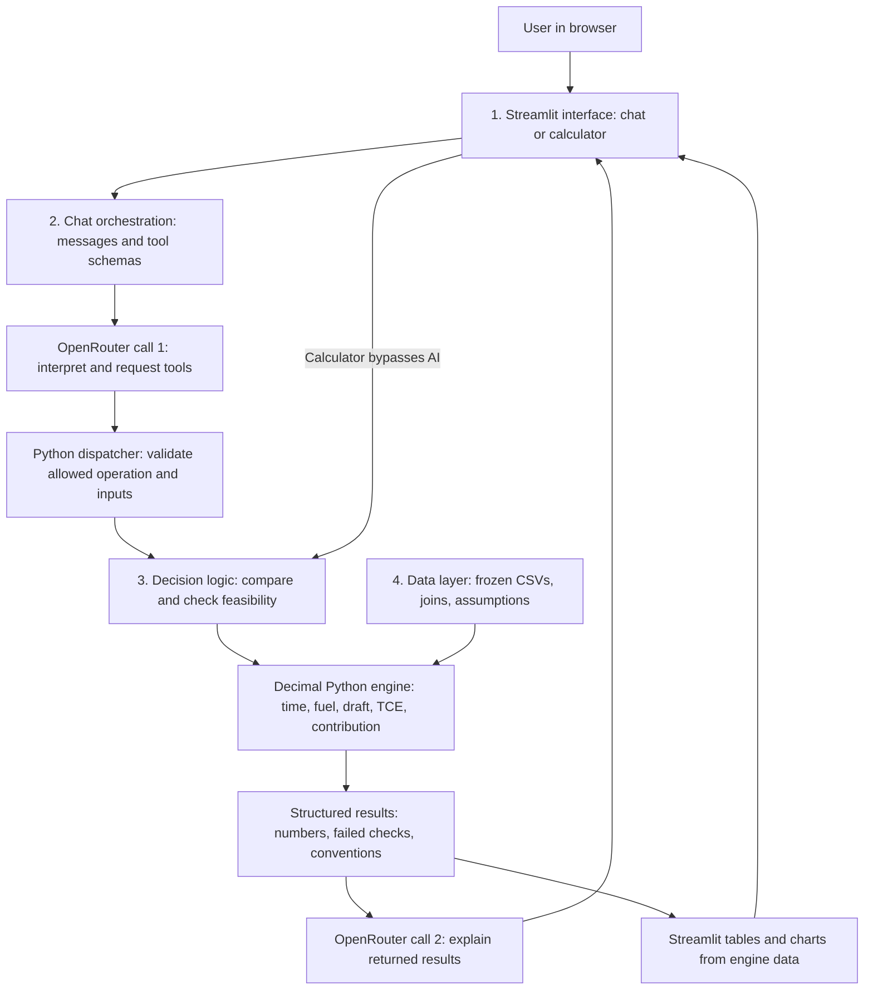

# Voyage assistant architecture

Four logical layers run in one Python/Streamlit application. OpenRouter is the external model API. There is no local LLM, separate frontend build, vector database or embedding step.

| Layer | Files | Responsibility |
|---|---|---|
| Interface | `app.py`, `voyage/dashboard.py`, `voyage/dashboard_data.py`, `voyage/dashboard.css`, `voyage/chat_view.py`, `voyage/ui.py` | Dashboard, dark/light themes, selection controls, chat, tables, charts and exports |
| Interaction | `voyage/chat.py`, `voyage/tools.py`, `voyage/openrouter.py` | Prompt, model calls, schema validation, allowlisted tools |
| Decision and calculation | `voyage/decision.py`, `voyage/engine.py` | Feasibility, comparison, Decimal calculations, structured output |
| Data | `voyage/data.py`, `data/raw/` | Read-only records, unique keys, required joins, baseline price coverage |

Decision and calculation are separate modules within layer 3. This preserves the brief's calculation, decision and interaction responsibilities. Module boundaries support future expansion without needing additional servers now.

## Example request

User asks: “Compare managed vessels for CC-02 at 164,000 tonnes.” The first model call requests `compare_vessels` with the cargo and lift. Python validates the arguments and calculates four voyages. The second model call explains the returned results. Streamlit renders those same results into tables and charts. No model-generated code executes.

General terminology questions may use one model call without tools. Calculations use at most two model calls and four tool requests. If the explanation fails, computed evidence is still displayed. No automatic API retries consume quota. Dashboard selections and voyage calculations work without a key. The chat receives the current UI selection as context and must still call Python tools for numeric answers.

## Implemented scope

- Catalog of all 15 vessels and 11 cargoes.
- Calculations for four managed vessels and three committed cargoes at an explicit lift and month.
- Quantity, laycan, deadweight and draft checks; infeasible results omitted from comparison charts.
- TCE, contribution, duration and detailed results. Comparisons order feasible voyages by contribution; no fleet-level optimum claim.
- Regression against the single supplied validation row, including 25 numeric fields at published precision.
- Server-side key and free-only routing with zero maximum prompt/completion prices.

## Conventions requiring team agreement

- Economical speeds; ballast, waiting, loading, laden and discharge time all included.
- Default bunker month explicitly March 2026, at the load-port pricing location. The reference does not distinguish arrival-month from availability-month pricing.
- Draft margin 0.3 m below the minimum summer/load-port/discharge-port limit. This generalisation requires sign-off.
- Canal cost provisionally zero because route canal costs are absent.
- Fuel expense uses consumption times price; opening ROB affects purchase planning.
- TCE excludes hire; contribution deducts voyage hire. Different durations mean this is not a common-horizon fleet optimum.
- Original source README/dictionary use Project 4 while the brief says Project 3; originals are preserved.

## Next additions

Market quote inputs and calculations; explicit delay and bunker scenarios; allocation objectives and common-horizon comparisons; Streamlit Community Cloud deployment. Optimisation and slider controls can follow the basic scenarios. These are not implemented yet.

The free router may select different models/providers per call. Evaluate and pin a free tool-capable model before demonstration. Native tool support is requested; unavailable providers produce a visible error. A model can still omit tools or answer inaccurately, so numeric evidence is displayed separately and AI prose requires review. This is not a guarantee against hallucinations.

## Hosting and secrets

VS Code runs Streamlit locally; GitHub stores code and synthetic inputs; OpenRouter runs the model remotely. Later, Streamlit Community Cloud can run this same app with its Secrets settings. The key stays on the server, outside browser configuration and tool results.

Chat messages and requested tool results go to OpenRouter/model providers. Session history stays in server memory, not a database. Only ten recent exchanges plus the new question are sent. Follow-up calculations must rerun tools; prior AI prose is not authoritative evidence.

## References

- [OpenRouter tool calls](https://openrouter.ai/docs/guides/features/tool-calling)
- [Streamlit chat input](https://docs.streamlit.io/develop/api-reference/chat/st.chat_input)
- [Streamlit chat messages](https://docs.streamlit.io/develop/api-reference/chat/st.chat_message)
